# 18 - SOAR Console and Incident Response Workflow

## 1. Objective

The objective of this stage was to extend the existing Wazuh-based monitoring environment into a practical, analyst-driven security-operations workflow.

The previous stages established:

- Enterprise Windows infrastructure.
- Sysmon and Windows security telemetry.
- Centralized Wazuh SIEM monitoring.
- Controlled attack simulation.
- FortiGate network-security controls.
- FortiGate → Wazuh Syslog integration.
- SOC monitoring and event-level investigation through the Wazuh Dashboard.

This stage adds a custom-built **SOAR Console** above the existing SIEM layer.

The SOAR Console manages the analyst workflow after a security alert has been detected by Wazuh. It provides alert queue management, analyst ownership, investigation tracking, IOC extraction, human-triggered threat-intelligence enrichment, disposition, escalation, reporting, and auditability.

The resulting architecture is:

```text
Windows / Sysmon agents ──┐
                          ▼
                    Wazuh Manager  ◄── Syslog / UDP 514 ── FortiGate
                          │
                          │  /var/ossec/logs/alerts/alerts.json
                          ▼
                 Wazuh Reader (read-only SSH)
                          │
                          ▼
                    Wazuh Ingestor
        (normalization / deduplication / IOC extraction)
                          │
                          ▼
              SQLite SOAR Database ◄──► Enrichment Worker ──► VirusTotal API
                          ▲              (background thread)   (analyst-requested)
                          │
                  SOAR Service Layer
                          ▲
                          │
                    SOAR Console GUI
                          │
                          ▼
        Analyst Decision:  CLOSED  or  ESCALATED
                          │
                          ▼
                     Audit Trail
```

The SOAR implementation is a **human-in-the-loop** workflow. The system does not automatically classify an alert as malicious or automatically escalate an event simply because an IOC is present. Analyst actions explicitly drive every workflow transition.

---

## 2. Architecture Role of the SOAR Console

The SOAR Console does not replace Wazuh.

Wazuh remains responsible for:

- Event collection.
- Log processing.
- Rule evaluation.
- Alert generation.
- SIEM-level monitoring and investigation.

The SOAR Console operates as the next operational layer:

```text
Detection / Monitoring
        ↓
Alert Ingestion
        ↓
Prioritization
        ↓
Assignment
        ↓
Investigation
        ↓
IOC / CTI Enrichment
        ↓
Analyst Decision
        ↓
Close or Escalate
        ↓
Audit / Report
```

This creates a clear separation between **security telemetry and analyst workflow**: Wazuh answers *what happened*, and the SOAR Console supports *what the analyst does about it*.

---

## 3. Alert Ingestion Pipeline

The SOAR Console receives alerts from the existing Wazuh environment rather than replacing the Wazuh detection pipeline.

The implemented flow is:

```text
Wazuh Manager
     │
     ▼
/var/ossec/logs/alerts/alerts.json
     │
     ▼
Read-only SSH access
     │
     ▼
Wazuh Reader
     │
     ▼
Wazuh Ingestor
     │
     ▼
Normalization / Deduplication / IOC extraction
     │
     ▼
SOAR SQLite Database
```

The reader is managed by the SOAR application and maintains an SSH connection to the Wazuh Manager host, following the alert file with a polling-compatible `tail` so that appended alert records are consumed reliably.

For each alert, the ingestor stores the relevant Wazuh information in the SOAR data model:

- Wazuh source event ID.
- Rule ID and rule description.
- Original Wazuh rule level.
- Normalized SOAR severity.
- Event timestamp.
- Service / decoder context.
- Source and destination IP addresses where available.
- Agent information.
- The raw Wazuh event.

### Severity Normalization

The Wazuh rule level is mapped to a SOAR severity category:

| Wazuh rule level | SOAR severity |
|---|---|
| 0–3 | LOW |
| 4–7 | MEDIUM |
| 8–11 | HIGH |
| 12–16 | CRITICAL |

This is a SOAR normalization rule rather than a Wazuh label, and the original Wazuh level is retained alongside the normalized value.

### Alert Identity and Deduplication

Each alert receives a deterministic SOAR alert identifier derived from its Wazuh source event identifier.

The ingestion layer checks the source event identifier before creating an alert. This prevents the same Wazuh event from being inserted twice if the reader reconnects or encounters stream data it has already processed.

### Source Coverage

The reader consumes the Wazuh Manager's complete alert stream, so any source that Wazuh alerts on (Windows agents, FortiGate Syslog, or the manager host itself) is eligible to appear in the queue. The evidence captured for this document was produced by alerts raised on the manager host `amr-server`, as described in the next section.

---

## 4. Evidence Environment and Test Method

The evidence in this document was captured from a live session of the SOAR Console connected to the Wazuh Manager on `amr-server`.

The queue contains three kinds of records:

- **Live Wazuh alerts** raised on `amr-server` and ingested through the SSH reader (for example SSH authentication events, PAM sessions, listening-port changes reported by Wazuh, and AppArmor events).
- **Controlled test events.** To exercise the investigation and enrichment workflow in a repeatable way, controlled SSH authentication log entries were written on `amr-server` using the standard `logger` utility. Wazuh processed them like any other log, applying its native `sshd` decoders and rules. Public IP addresses used in these events included addresses taken from the abuse.ch Feodo Tracker botnet blocklist and a known-clean public resolver address used as a negative control. These were log entries only; no connection was made to any of those hosts.
- **Three seeded development records** (`ALT-1001` to `ALT-1003`) remaining from early prototyping. `ALT-1002` is visible in the escalation report list in Figure 14.

The escalation scenario documented in Section 12 therefore demonstrates the **workflow**: a simulated SSH brute-force sequence followed by a successful login from an externally flagged address. It is not presented as a real compromise of the lab.

Windows endpoint and FortiGate-originated alerts flow through the same Wazuh stream but were not part of this evidence session.

---

## 5. Alert Queue and Prioritization

The SOAR Console provides a centralized alert queue with workflow and severity filters.

Available queue views are:

```text
All Active
Critical
High
Medium
Low
Unassigned
Assigned to Me
Investigating
Escalated
Closed
```

The dashboard also exposes operational metrics for:

- Critical active alerts.
- Unassigned active alerts.
- The current analyst's active alerts.

A **Refresh Queue** control updates the view on demand. When new alerts arrive from the reader, the console shows a non-intrusive "new data available" indicator instead of re-rendering the queue underneath the analyst.

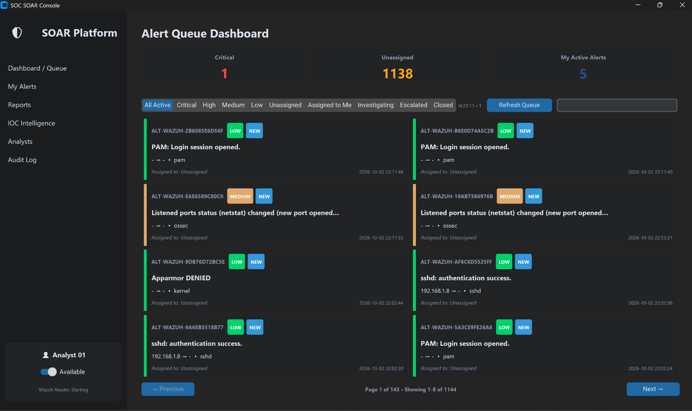

**Figure 1 — SOAR Console dashboard showing operational metrics, severity and workflow-state filters, the queue refresh control, alert search, the reader status indicator, and paginated alert cards.**

In the captured session the active queue held 1,144 alerts, displayed across 143 pages at 8 alerts per page.

---

## 6. Alert Filtering and Search

Severity-based filtering provides a rapid method for prioritization.

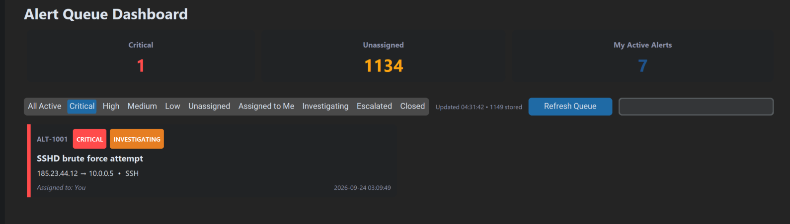

**Figure 2 — Critical alert filtering in the SOAR Console.**

A critical alert can be isolated from the larger queue and opened directly for investigation.

Workflow-state filtering is also available. Escalated alerts can be isolated independently from active or closed alerts.

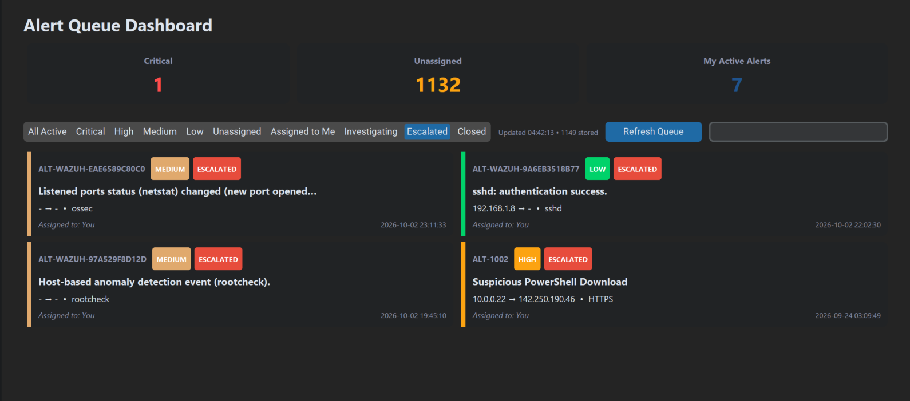

**Figure 3 — Escalated alert queue filtered to the ESCALATED workflow state.**

The filter model separates **Wazuh severity** from the **SOAR workflow state**. A medium-severity event can therefore be escalated, while a critical event may remain under investigation until an analyst completes the required workflow.

### Search

The queue also provides text search across the key analyst-facing alert fields.

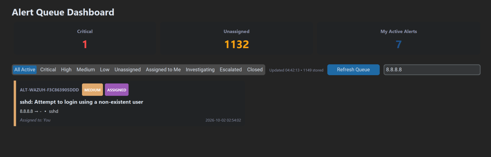

**Figure 4 — Alert search returning a matching alert from the queue.**

Search matches against:

- Alert ID.
- Rule description and rule ID.
- Source IP and destination IP.
- Assigned analyst.
- Severity.
- Service.
- Agent.

This complements the severity and state filters and gives the analyst a simple pivot without direct database queries.

---

## 7. Analyst Ownership and Investigation Workflow

The workflow begins with a newly ingested alert in the `NEW` state.

The analyst can open the alert without first claiming it. This preserves visibility while preventing accidental ownership changes.

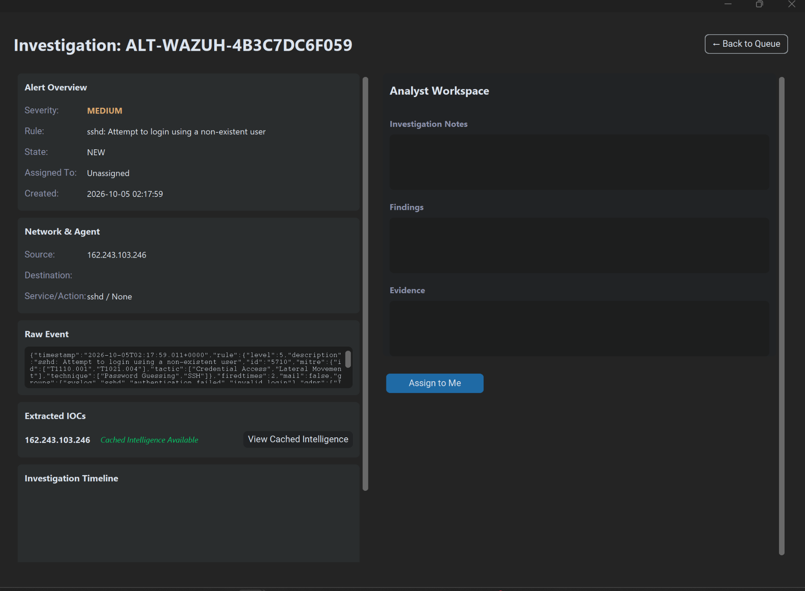

**Figure 5 — New, unassigned Wazuh alert opened in the Investigation Workspace.**

The alert view presents the underlying security context before any workflow transition is made. In this example the extracted source IP already shows cached intelligence from an earlier lookup, demonstrating that previously retrieved reputation data is reused (Section 10).

The analyst then explicitly claims the alert:

```text
NEW + Unassigned
       ↓
Assign to Me
       ↓
ASSIGNED
```

After claiming the alert, the same analyst starts the investigation:

```text
ASSIGNED
   ↓
Start Investigation
   ↓
INVESTIGATING
```

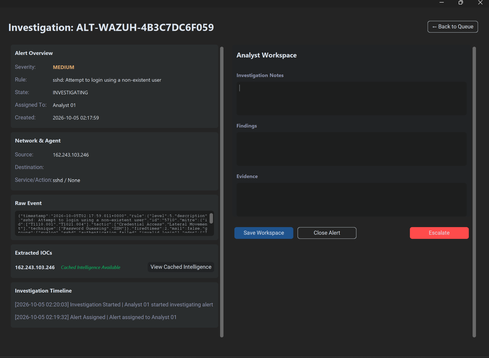

**Figure 6 — Alert assigned to Analyst 01 and transitioned into the INVESTIGATING state.**

Ownership is enforced by the service layer: only the assigned analyst can start the investigation, close the alert, or escalate it.

---

## 8. Investigation Workspace

The Investigation Workspace combines the information required to analyze an alert without leaving the SOAR Console.

### Alert Overview

- Alert ID.
- Severity.
- Rule description.
- Current workflow state.
- Assigned analyst.
- Creation time.

### Network and Agent Context

- Source address.
- Destination address where available.
- Service and action.
- Agent context.

### Raw Event

The original Wazuh event is retained for analyst review. This preserves context that normalized fields alone may not represent, such as the rule's MITRE ATT&CK mapping and groups.

### Extracted IOCs

The workspace lists indicators associated with the alert and lets the analyst request external enrichment when appropriate.

### Analyst Workspace

The analyst can record:

- Investigation notes.
- Findings.
- Evidence.

The page also displays the investigation timeline so that workflow actions remain visible alongside the investigation state.

This creates a single investigation context around the alert rather than forcing the analyst to manage notes separately from the underlying event.

---

## 9. IOC Extraction

During ingestion, the SOAR extracts enrichable indicators from each alert and links them to it:

- **Public IP addresses** (IPv4 and IPv6) from the source and destination fields.
- **File hashes** (MD5, SHA-1, SHA-256) from Wazuh file-integrity (syscheck) data when present.

Private, loopback, link-local, and other non-routable addresses are intentionally **not** treated as external indicators. For example:

```text
127.0.0.1       → loopback / local
192.168.x.x     → private
10.x.x.x        → private
172.16.x.x–172.31.x.x → private
```

This avoids sending internal addressing to a third-party service and keeps the IOC list focused on external indicators.

Extraction never contacts an external service. It only records the indicator against the alert.

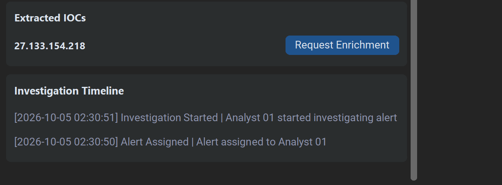

**Figure 7 — Extracted public IOC with an explicit analyst-triggered enrichment action.**

The analyst must explicitly request enrichment. IOC enrichment is therefore **not triggered automatically merely because an indicator exists**.

---

## 10. Threat-Intelligence Enrichment

The SOAR Console integrates with the VirusTotal API (v3) for IOC enrichment.

The workflow is asynchronous:

```text
Analyst requests enrichment
          ↓
Request stored in the database
          ↓
Background worker picks up the request
          ↓
VirusTotal lookup
          ↓
Result stored / cached
          ↓
SOAR Console displays the result
```

### Enrichment Request

The request is recorded in the SOAR database before the external lookup is performed.

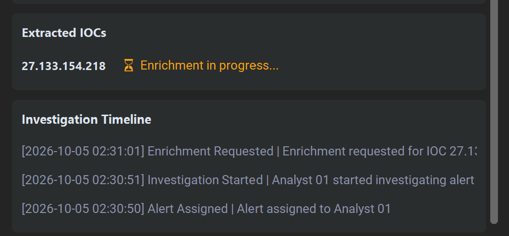

**Figure 8 — IOC enrichment request in progress while the background worker processes it.**

This asynchronous model prevents a potentially slow external API request from blocking the GUI. While a request is pending, the IOC section refreshes itself so the result appears without the analyst reopening the alert, and without overwriting notes the analyst is typing.

### Completed Enrichment

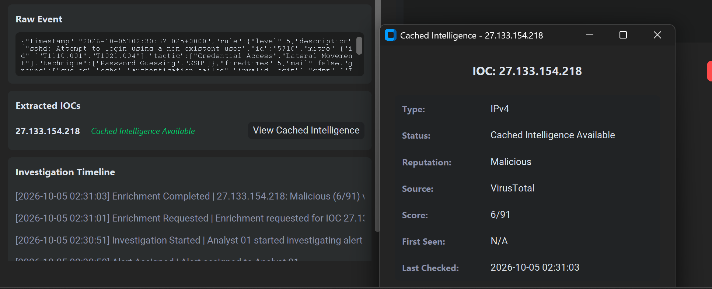

**Figure 9 — Completed VirusTotal enrichment displayed within the investigation context, with the corresponding enrichment events in the investigation timeline.**

The cached intelligence record contains:

- IOC type.
- Enrichment status.
- Reputation.
- Source.
- Detection score (malicious engines / total engines).
- First-seen date where VirusTotal provides one.
- Last-checked timestamp.
- Additional VirusTotal context stored with the record, including a link to the VirusTotal report.

### Reputation Classification

The reputation label is derived from VirusTotal's engine results:

| Condition | Reputation |
|---|---|
| 3 or more engines flag the indicator as malicious | Malicious |
| 1–2 engines flag it as malicious, or any as suspicious | Suspicious |
| Analyzed with no detections | Clean |
| No analysis data available | Unknown |
| Indicator not known to VirusTotal | Not Found |
| Private / non-routable address (resolved locally) | Internal |

The malicious threshold is deliberately above one, because a single-engine detection is a common false-positive pattern. It is a configurable constant rather than a fixed rule.

### Caching

When intelligence already exists in the SOAR database, the analyst views the cached result instead of triggering another external request. Cached intelligence persists across application restarts and is shared by every alert that contains the same indicator.

This reduces unnecessary external lookups, preserves the consistency of the intelligence history, and conserves the limited quota of the free VirusTotal API tier.

### External API Safety Controls

- Internal and private addresses are never submitted to VirusTotal.
- Only the indicator value itself (a public IP address or file hash) is sent. Alert content, hostnames, and raw logs are not.
- The enrichment worker paces requests to stay within the free-tier rate limit, and re-queues a request if VirusTotal reports that the limit was reached.
- Authentication failures, missing indicators, malformed responses, and network errors are handled explicitly and recorded with a reason.
- A failed lookup can be retried by the analyst through the normal enrichment action.
- Requests interrupted by an application shutdown are returned to the queue at the next start instead of staying permanently "in progress".

Figure 15 in Section 13 shows this behavior in the audit log: an early lookup of a public resolver address failed because the API key had not yet been configured, and the retry after configuration returned a clean result.

---

## 11. Alert Disposition and Closure

Once the analyst has enough information to make a decision, the alert can be closed with a required disposition.

The available dispositions are:

```text
True Positive
False Positive
Benign
Duplicate
Other
```

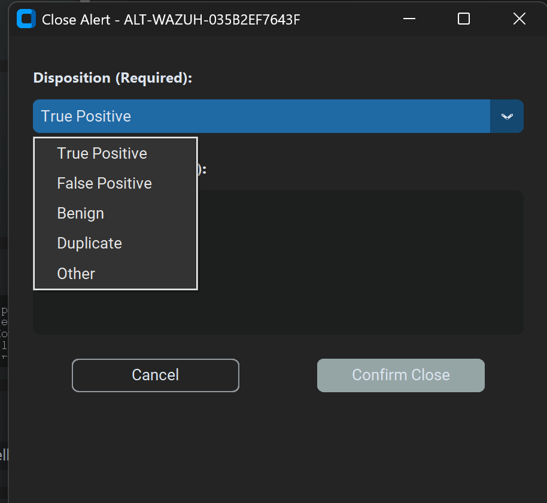

**Figure 10 — Close Alert dialog showing the required disposition selection.**

The disposition is stored with the closure action and becomes part of the audit trail.

The resulting transition is:

```text
INVESTIGATING
      ↓
CLOSED
```

The closed queue provides a separate view of completed cases.

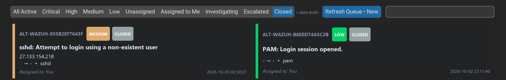

**Figure 11 — Closed alert queue containing completed cases.**

A closed alert can be reopened for review in read-only form, with its timeline preserved.

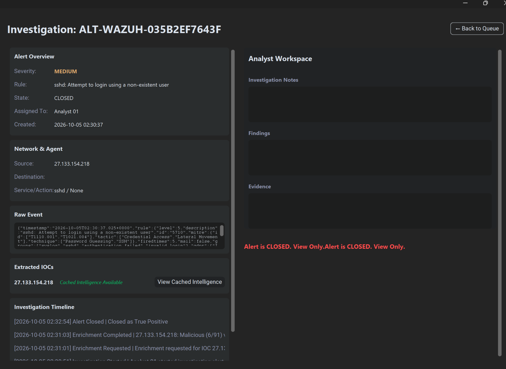

**Figure 12 — Closed alert displayed in view-only mode with the historical investigation timeline.**

The closure action and the CTI enrichment remain visible as historical workflow events.

---

## 12. Escalation Workflow

The second primary outcome is escalation.

Escalation is intended for cases that require management or higher-level response. It is only available to the assigned analyst, and only from the `INVESTIGATING` state.

The workflow requires an investigation report before the escalation can be submitted:

```text
INVESTIGATING
      ↓
Escalate
      ↓
Mandatory Investigation Report
      ↓
Submit Escalation
      ↓
ESCALATED
```

The report has four required sections, and the service rejects a section that is empty or trivially short:

- Executive summary.
- Evidence collected.
- Investigation findings.
- Recommended action.

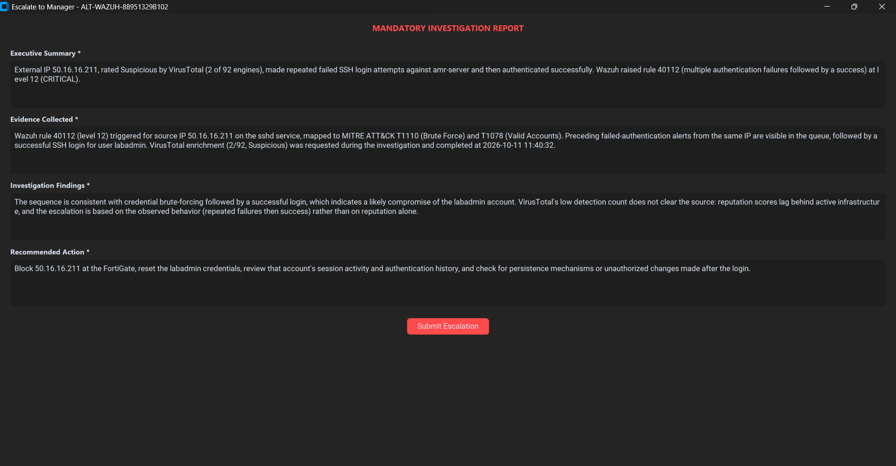

**Figure 13 — Mandatory investigation report completed before escalation, for the simulated SSH brute-force-then-login scenario described in Section 4.**

After submission, the alert enters the `ESCALATED` state and a report record is created with the status *Awaiting Management*. The report keeps the alert's severity and links back to the alert and its timeline.

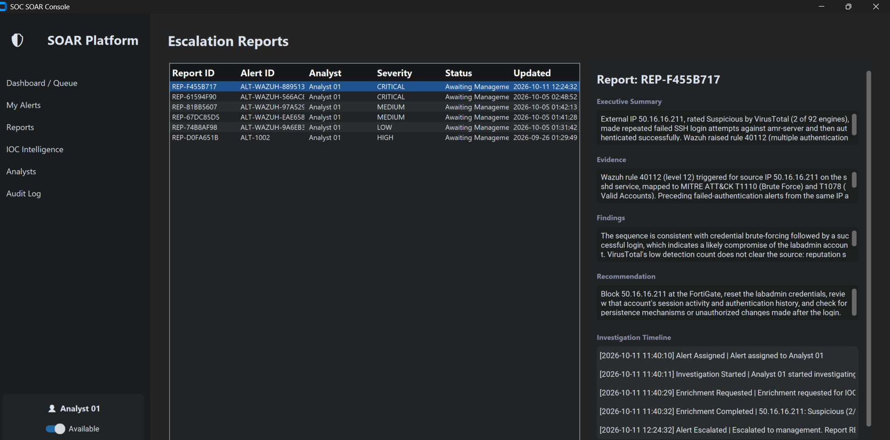

**Figure 14 — Escalation reports list and the generated report showing the executive summary, evidence, findings, recommendation, and investigation timeline.**

The report converts the investigation into a structured handoff rather than simply changing the alert state.

---

## 13. Auditability

All significant workflow actions are recorded in the SOAR audit log.

The audit layer records analyst and system actions such as:

- Alert assignment.
- Investigation start.
- Workspace updates.
- IOC enrichment requests.
- Enrichment completion or failure.
- Alert closure.
- Alert escalation.
- Analyst availability changes.

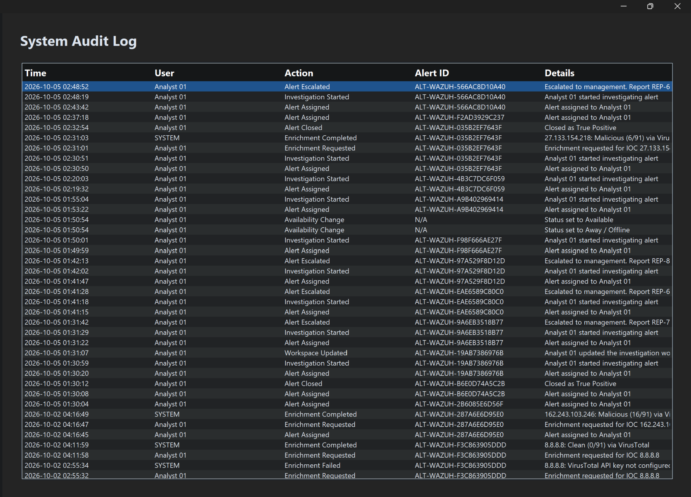

**Figure 15 — System Audit Log containing analyst and system workflow events.**

The log distinguishes actions taken by **Analyst 01** from events produced by the background enrichment worker, which are attributed to **SYSTEM**. It also records the lifecycle of individual lookups, including the failed-then-successful 8.8.8.8 sequence noted in Section 10 and the enrichment results for the flagged addresses used in the evidence.

The audit history can answer questions such as:

```text
Who handled the alert?
When was the investigation started?
Was CTI requested?
What did the enrichment service return?
When was the alert closed or escalated?
What report was generated?
```

---

## 14. Multi-Analyst Data Model

The SOAR data model includes multiple analysts and separates analyst availability from alert assignment.

The current console contains:

- Analyst 01.
- Analyst 02.
- Analyst 03.

Availability does not automatically assign alerts. The analyst must explicitly claim an eligible alert.

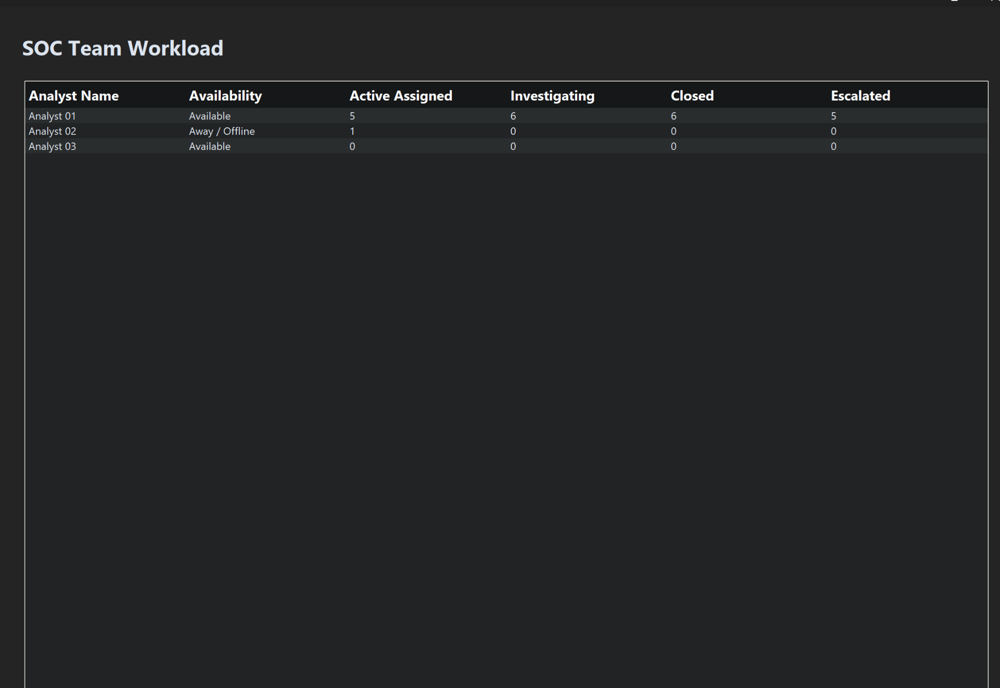

**Figure 16 — SOC team workload view showing analyst availability and per-analyst alert counts.**

The workload view shows, for each analyst:

- Availability.
- Active assigned alerts.
- Investigating alerts.
- Closed alerts.
- Escalated alerts.

This gives a basic operational view of workload without changing the underlying ownership rules.

In the current build the console is operated as a single local session (Analyst 01). The other analyst records demonstrate the multi-analyst data model and workload reporting; a login and analyst-switching mechanism is not part of this stage (see Section 22).

---

## 15. Workflow State Model

The workflow model is:

```text
             ┌─────────────┐
             │     NEW     │
             └──────┬──────┘
                    │ Assign to Me
                    ▼
             ┌─────────────┐
             │   ASSIGNED  │
             └──────┬──────┘
                    │ Start Investigation
                    ▼
          ┌───────────────────┐
          │   INVESTIGATING   │
          └─────────┬─────────┘
                    │
            ┌───────┴────────┐
            │                │
         Close            Escalate
            │                │
            ▼                ▼
       ┌────────┐      ┌────────────┐
       │ CLOSED │      │ ESCALATED  │
       └────────┘      └────────────┘
```

The model deliberately separates workflow state from the original Wazuh rule severity.

For example:

```text
Severity = MEDIUM
State    = ESCALATED
```

is a valid case, because escalation is a workflow decision rather than a synonym for severity.

---

## 16. Components and Service Separation

The implementation is structured around a service layer between the GUI and the database.

```text
SOAR GUI
   ↓
SOAR Service
   ↓
Database Layer
   ↓
SQLite
```

The service layer enforces workflow behavior (ownership, valid state transitions, mandatory report content) and validates analyst operations before changes are committed. The database layer stores operational state and historical records.

| Component | Responsibility |
|---|---|
| Wazuh Reader | Follows the Wazuh alert stream over read-only SSH and reconnects after unexpected exits. |
| Wazuh Ingestor | Normalizes Wazuh events, derives severity, deduplicates by source event ID, and links extracted IOCs. |
| IOC Extractor | Identifies public IP addresses and file hashes eligible for enrichment. |
| Database Layer | SQLite persistence for alerts, analysts, investigations, IOCs, intelligence, enrichment requests, reports, and audit events. |
| SOAR Service | Workflow rules, ownership checks, state transitions, escalation validation, audit recording. |
| Enrichment Worker | Background thread that fulfils analyst enrichment requests and records outcomes. |
| VirusTotal Client | API v3 client that returns normalized reputation results and typed errors. |
| SOAR GUI | Analyst-facing console: queue, investigation workspace, reports, IOC intelligence, analysts, audit log. |

This separation lets the presentation layer focus on analyst interaction while workflow rules and persistence remain in their own layers.

---

## 17. Live Wazuh Reader Lifecycle

The SOAR Console manages the Wazuh reader as part of the application lifecycle.

The GUI starts the reader and monitors its state. The reader is restarted automatically when the external process exits unexpectedly.

The console shows the reader state in the sidebar, flags the arrival of new alerts, and provides a manual **Refresh Queue** action so queue updates stay under the analyst's control.

Because the reader is an external process, it needs lifecycle handling independent of the GUI event loop; this is why reconnection is handled outside the interface thread.

When a reader problem needs diagnosing, the reader can also be run on its own (`python wazuh_reader.py --mode follow`), which prints the underlying SSH output. This was used during the log-rotation incident described in Section 21.

---

## 18. Large-Queue Handling

A major implementation requirement was keeping the console usable as the alert population grows.

The implementation separates data retrieval from GUI rendering:

```text
Database
   ↓
Full alert dataset
   ↓
Service queue representation
   ↓
GUI filtering and search
   ↓
8 visible alert cards per page
```

The captured session showed:

```text
Active queue results: 1,144
Pages: 143
Page size: 8
```

These values reflect the captured environment at that time and are not application limits.

Pagination keeps the full alert population accessible without creating a GUI widget for every alert at once.

---

## 19. Validation and Verification

The implementation was validated with automated tests and with a live session against the Wazuh Manager.

| Validation Area | Method | Result |
|---|---|---|
| Wazuh event normalization and severity mapping | `test_wazuh_ingest.py` | PASS |
| Source-event deduplication | `test_wazuh_ingest.py` | PASS |
| Workflow rules: assignment, investigation, closure, escalation, audit | `test_soar_service.py` | PASS |
| IOC extraction (public IPs, file hashes, private-range exclusion) | `test_enrichment.py` | PASS |
| VirusTotal client: reputation classification, error handling | `test_enrichment.py` | PASS |
| Enrichment lifecycle: request, worker, caching, retry, rate-limit re-queue | `test_enrichment.py` | PASS |
| Private addresses never sent to VirusTotal | `test_enrichment.py` | PASS |
| IOC extraction failure never loses an alert | `test_enrichment.py` | PASS |
| Live ingestion from the Wazuh Manager over SSH | Live session (Figures 1, 5) | PASS |
| Live VirusTotal lookup: malicious result | Live session (Figures 9, 15) | PASS |
| Live VirusTotal lookup: clean result, and retry after failure | Live session (Figure 15) | PASS |
| Analyst assignment and investigation workflow | Live session (Figure 6) | PASS |
| Alert closure with disposition | Live session (Figures 10–12) | PASS |
| Escalation with mandatory report | Live session (Figures 13–14) | PASS |
| Audit trail | Live session (Figure 15) | PASS |
| Multi-analyst workload data | Live session (Figure 16) | PASS |
| Large-queue pagination | Live session (Figure 1) | PASS |

The automated enrichment tests simulate the VirusTotal network responses, which makes error and rate-limit behavior repeatable without consuming API quota. The live results above come from the real VirusTotal service.

File-hash extraction and lookup are covered by the automated tests; the live evidence in this document uses IP indicators.

---

## 20. Security Considerations

The reader connects with a dedicated, non-administrative Linux account using key-based SSH. The reader performs a read-only `tail` of the alert file and does not use elevated privileges or modify the Wazuh configuration.

Read access to the Wazuh alert logs is granted at the **group level** rather than on individual files. Wazuh recreates `alerts.json` during its daily log rotation, and permissions applied to the old file did not carry over to the new one (Section 21). In a lab environment, group-level access may cover more of the Wazuh log directory than the alert file alone. A production deployment should scope this access narrowly, for example with default ACLs limited to the alert directory.

The VirusTotal API key is treated as a secret. It is supplied through an environment variable or a local key file that is excluded from source control, and it is never written to the SOAR database, the audit log, or the console output.

Only indicator values (public IP addresses and file hashes) are sent to VirusTotal. Private addresses, alert content, hostnames, and raw logs are not.

The captured screenshots exclude credentials and other secret material.

---

## 21. Lessons Learned

- A SIEM answers what was detected; a separate workflow layer is needed to record who owns an alert, what was checked, and why it was closed or escalated.
- Keeping enrichment analyst-triggered limits third-party exposure and API quota use, and keeps the human decision visible in the audit trail.
- Daily log rotation can silently break a log reader. After midnight rotation, Wazuh recreated `alerts.json` without the file-level permission that had been granted on the old file, and the reader looped on "permission denied" while the queue stopped updating. Granting access at the group level fixed the cause rather than the symptom.
- A background reader that reconnects automatically also needs a way to see *why* it keeps reconnecting. Running the reader on its own exposed the underlying SSH error immediately.
- Development seed data must never overwrite real results. A startup routine that re-seeded placeholder intelligence could overwrite lookup results for the seeded indicators at every launch, and was changed to seed only when no intelligence exists.
- An early enrichment attempt failed cleanly because the API key had not been configured. Recording the failure with a reason, and allowing a retry, made the problem obvious and easy to fix.
- Treating a "not found" lookup as a valid cached result, rather than an error, matches how analysts use threat-intelligence sources.
- Separating workflow state from detection severity avoids conflating "how serious the rule is" with "what the analyst decided".

---

## 22. Current Scope and Limitations

The current SOAR Console demonstrates:

- Wazuh alert ingestion over read-only SSH.
- Alert normalization, severity mapping, and deduplication.
- Alert queue management with filtering, search, and pagination.
- Analyst ownership and investigation tracking.
- IOC extraction for public IPs and file hashes.
- Human-triggered VirusTotal enrichment with caching, retry, and rate-limit handling.
- Alert closure with disposition.
- Escalation with a mandatory investigation report.
- Audit logging of analyst and system actions.
- Multi-analyst workload reporting.
- Managed reader lifecycle with automatic restart.

The current implementation has these limitations:

- **No response actions.** The console records decisions and reports; it does not block IPs on the FortiGate or act on endpoints.
- **Single analyst session.** The console runs as Analyst 01. Login and analyst switching are not implemented, although the data model supports multiple analysts.
- **Enrichment scope.** Only public IPs and file hashes are extracted and enriched. Domains and URLs are not extracted from alerts, and VirusTotal is the only intelligence source.
- **API quota.** The free VirusTotal tier limits lookups to a few per minute and a few hundred per day, so enrichment is paced and one lookup at a time.
- **No cache expiry.** Cached intelligence is reused indefinitely; reputation can change over time, and a refresh-after-N-days policy has not been added.
- **No backfill after an outage.** The reader follows the alert stream from the end of the file, so alerts generated while it was not running are not retroactively ingested.
- **Evidence scope.** The evidence alerts come from `amr-server`, including controlled test events. Windows endpoint and FortiGate alerts use the same pipeline but were not part of the evidence session.
- **Local storage.** SQLite on a single machine, appropriate for a lab but not for a multi-user deployment.

The implementation is intentionally a **human-in-the-loop SOAR workflow** rather than an autonomous response engine.

Possible future work builds on the existing architecture:

```text
Network + Endpoint Correlation
          ↓
Custom Detection Engineering
          ↓
Threat Hunting
          ↓
Automated Playbooks
          ↓
Controlled Response Actions
```

Any future response action, such as a FortiGate block, would require explicit authorization and safety controls. None of these capabilities are represented as implemented in this stage.

---

## 23. Relationship to Previous Project Stages

The SOAR Console is the next layer in the project's evolution:

```text
01–04  Core Infrastructure
05–08  Windows / Active Directory
09     Sysmon / Endpoint Telemetry
10–11  Wazuh SIEM + Agents
12     Attack Simulation
13–15  FortiGate / VPN / Wazuh Network Changes
16     FortiGate → Wazuh Integration
17     SOC Monitoring Dashboard
18     SOAR Console / Incident Workflow
```

The architecture therefore evolves from telemetry collection to monitoring, and from monitoring to analyst-driven incident workflow.

---

## 24. Result

The SOAR Console extends the existing SIEM environment into a structured security-operations workflow.

The verified operational path is:

```text
Wazuh Manager (alerts.json)
            ↓
   Read-only SSH Reader
            ↓
  Ingestion / Deduplication
            ↓
       Alert Queue
            ↓
      Analyst Claim
            ↓
      Investigation
            ↓
   IOC / VirusTotal CTI
            ↓
     Analyst Decision
        /         \
       ▼           ▼
    Closed      Escalated
       │           │
       │     Investigation Report
       │           │
       └─────┬─────┘
             ▼
        Audit Trail
```

The result is a clear operational boundary:

- **Wazuh** provides detection and SIEM visibility.
- **The SOAR Console** manages the analyst workflow around those alerts.
- **VirusTotal** provides external IOC intelligence when explicitly requested.
- **SQLite** provides persistence for workflow, investigations, intelligence, reports, and audit history.

The project has moved from a security-monitoring laboratory toward a more complete security-operations environment.

---

## 25. Implementation Access

The SOAR Console implementation is published in a separate public repository: [SOC-SOAR-Console](https://github.com/amr294/SOC-SOAR-Console). It contains the Python application, database schema and persistence layer, Wazuh reader and ingestor, IOC extraction, VirusTotal client, asynchronous enrichment worker, service layer, GUI, and the standalone test scripts referred to in Section 19 (`test_wazuh_ingest.py`, `test_soar_service.py`, and `test_enrichment.py`), together with setup and run instructions.

This document provides the integrated lab context:

- Architecture and integration boundaries.
- Workflow documentation.
- Operational screenshots and validation evidence.
- Validation methods.
- Security considerations and limitations.

The two repositories have separate purposes. This repository is the comprehensive lab documentation, and no source files are duplicated here. The source repository holds the implementation.

The source code is publicly viewable, but public availability is not permission to reuse it. The source repository includes no license granting general rights to reuse, redistribute, or create derivative works from the code.

---

## Related Documentation

- [00 - Current Lab Architecture](00-Current-Lab-Architecture.md)
- [10 - Wazuh SIEM Deployment](10-Wazuh-SIEM-Deployment.md)
- [11 - Wazuh Agent Deployment](11-Wazuh-Agent-Deployment.md)
- [12 - Attack Simulation](12-Attack-Simulation.md)
- [13 - FortiGate Network Edge](13-fortigate-network-edge.md)
- [14 - FortiGate Remote Access VPN](14-FortiGate-Remote-Access-VPN.md)
- [15 - Wazuh Dashboard Port Migration](15-Wazuh-Dashboard-Port-Migration.md)
- [16 - FortiGate → Wazuh Integration](16-FortiGate-Wazuh-Integration.md)
- [17 - SOC Monitoring Dashboard](17-SOC-Monitoring-Dashboard.md)
- [SOC-SOAR-Console](https://github.com/amr294/SOC-SOAR-Console) (source code and standalone tests, separate repository)

---

## Evidence

The evidence for this stage consists of 16 screenshots in `images/18-SOAR-Console/`, corresponding to Figures 1–16 in this document. They were captured from a live SOAR Console session connected to the Wazuh Manager on `amr-server`. Credentials and API keys are not shown.
